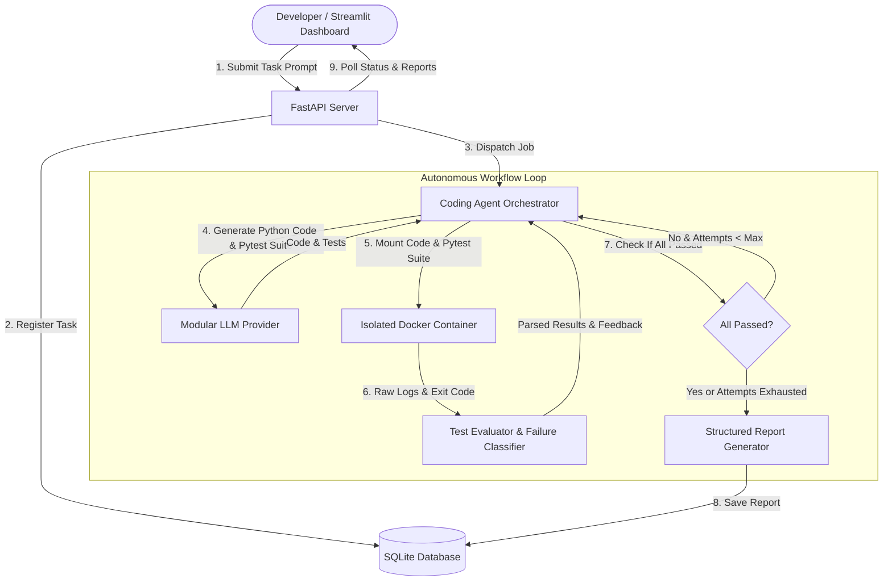

# Autonomous AI Coding Agent ⚡

An autonomous, production-minded AI coding agent that accepts natural language programming tasks, generates Python implementations, creates comprehensive automated test suites, executes them in a secure, isolated Docker sandbox, analyzes execution failures, and performs iterative test-driven self-repair.

---

## Architecture Diagram



---

## Core Features

- **Natural Language Task Intake**: Submit coding tasks with specific constraints and edge cases.
- **Automated Test Generation**: Produces targeted pytest unit tests covering nominal, edge, and boundary scenarios.
- **Secure Sandbox Execution**: Executes code in an unprivileged, isolated Docker sandbox with non-root user, disabled networking, CPU/memory quotas, and read-only mounts.
- **Failure Classification**: Categorizes failures into `SYNTAX_ERROR`, `RUNTIME_ERROR`, `INCORRECT_OUTPUT`, `TIMEOUT`, and `SANDBOX_ERROR`.
- **Iterative Self-Repair Loop**: Inspects failure traces and queries the LLM to fix bugs up to a configurable number of attempts (default: 3).
- **Execution Reports & Persistence**: Retains full iteration history, test metrics, and limitations in a local SQLite database with zero secret leakage.
- **Streamlit Web Dashboard**: Interactive UI with real-time task polling, code diff/history viewer, and downloadable solution and JSON report artifacts.
- **FastAPI REST API**: Validated Pydantic endpoints for headless and programmatic agent execution.

---

## Technology Stack

- **Backend**: Python 3.10+, FastAPI, Uvicorn, Pydantic v2
- **Frontend**: Streamlit
- **Isolation**: Docker Engine API (`docker-py`)
- **Testing**: Pytest, Pytest-Asyncio
- **LLM Providers**: Modular architecture supporting OpenAI, Groq, DeepSeek, Ollama, and offline Mock provider
- **Persistence**: SQLite3
- **CI/CD**: GitHub Actions

---

## Prerequisites

1. **Python 3.10+** (Tested on Python 3.10, 3.11, 3.12).
2. **Docker** (Required for live isolated code execution).
3. Optional: API Key for OpenAI, DeepSeek, or Groq (or use the built-in offline `mock` provider for testing without an API key).

---

## Installation & Setup

1. **Clone the repository**:
   ```bash
   git clone https://github.com/your-username/autonomous-ai-coding-agent.git
   cd autonomous-ai-coding-agent
   ```

2. **Create and activate a virtual environment**:
   ```bash
   python3 -m venv .venv
   source .venv/bin/activate
   ```

3. **Install dependencies**:
   ```bash
   pip install -r requirements.txt
   ```

4. **Configure environment variables**:
   ```bash
   cp .env.example .env
   ```
   Edit `.env` to configure your LLM provider (`openai`, `groq`, `mock`, etc.) and credentials:
   ```ini
   LLM_PROVIDER=openai
   LLM_API_KEY=your_api_key_here
   LLM_MODEL=gpt-4o
   ```
   *(For offline evaluation without an API key, set `LLM_PROVIDER=mock`)*.

---

## Running the Application

### 1. Start the FastAPI Backend
```bash
source .venv/bin/activate
uvicorn api.server:app --reload --host 0.0.0.0 --port 8000
```
Interactive API docs are available at `http://127.0.0.1:8000/docs`.

### 2. Start the Streamlit Web Interface
In another terminal:
```bash
source .venv/bin/activate
streamlit run ui/app.py
```
Open your browser at `http://localhost:8501`.

### 3. Docker Compose (Alternative)
Run both backend and frontend simultaneously:
```bash
docker-compose up --build
```

---

## Running Automated Tests

Run the complete test suite:
```bash
source .venv/bin/activate
pytest -v
```

The test suite validates:
- Schema input and constraint validations.
- LLM code parsing and mock provider fallback.
- Test failure classification and traceback extraction.
- Agent repair loop termination and iteration counting.
- Database persistence and serialization.
- REST API endpoints.
- Sandbox security controls and Docker availability detection.

---

## API Documentation

| Method | Endpoint | Description |
| :--- | :--- | :--- |
| `GET` | `/health` | Health check & Docker sandbox availability status |
| `POST` | `/tasks` | Submit a coding task (`prompt`, `requirements`, `max_repair_attempts`) |
| `GET` | `/tasks/{task_id}` | Retrieve task processing status and summary |
| `GET` | `/tasks/{task_id}/report`| Retrieve detailed execution report and repair history |

### Example API Request
```bash
curl -X POST http://127.0.0.1:8000/tasks \
  -H "Content-Type: application/json" \
  -d '{
    "prompt": "Write a function `is_anagram(s: str, t: str) -> bool`.",
    "requirements": "Case-insensitive, ignore non-alphanumeric characters.",
    "max_repair_attempts": 3
  }'
```

---

## Security & Isolation Controls

The sandbox employs strict security boundaries:
1. **Disabled Networking**: `network_disabled=True` prevents SSRF, reverse shells, or remote package downloads.
2. **Non-Root Execution**: Runs under UID `65534` (`nobody:nogroup`).
3. **Resource Caps**: 256MB memory cap and CPU throttling prevent host Denial of Service.
4. **Read-Only Code Mounts**: Candidate code cannot modify test files or alter the harness.
5. **No Direct Host Fallback**: Refuses to run arbitrary code on the host if Docker is unavailable.

---

## Known Limitations & Future Improvements

- **Language Scope**: Currently supports Python 3; future iterations will expand sandboxes for TypeScript, Go, and Rust.
- **Complex Multi-File Projects**: Currently tailored for single-module functions and algorithms; future work will incorporate project-level file trees and AST refactoring.
- **Static Analysis**: Integrating `flake8` and `mypy` before sandbox execution to catch typing issues earlier.
