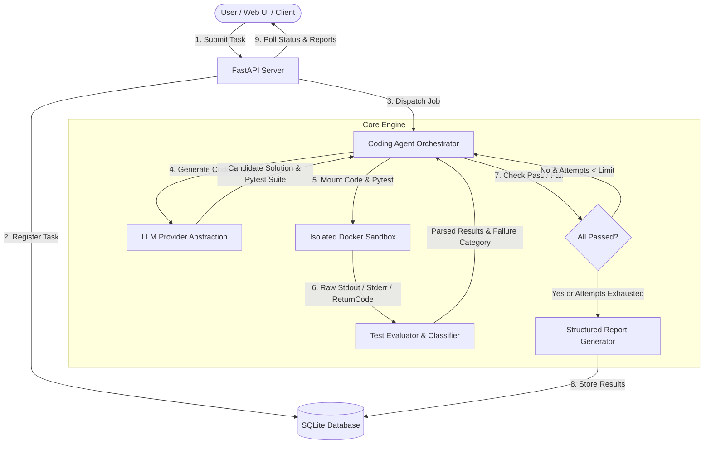

# Architecture Documentation

## System Overview

The **Autonomous AI Coding Agent** is an end-to-end framework designed to take natural language programming prompts, formulate candidate implementations, generate robust automated test suites, execute the generated code inside an isolated Docker sandbox, and iteratively repair failures based on execution feedback.

## Architectural Modules

### 1. `schemas/`
- Centralized data contracts defined with **Pydantic v2**.
- Models for task submission requests, test case results, sandbox execution summaries, repair iterations, and the comprehensive structured execution report.

### 2. `llm/`
- Provider interface `BaseLLMProvider` defining standard completion mechanics.
- `OpenAILikeProvider` supporting OpenAI, DeepSeek, Groq, local Ollama, and generic compatible endpoints.
- `MockLLMProvider` deterministic provider enabling complete automated unit and regression testing without requiring third-party API keys.
- Robust code extraction handling both fenced Markdown and raw script outputs.

### 3. `sandbox/`
- Enforces strict Docker containerization for untrusted code execution.
- Security controls:
  - Non-root UID (`65534:65534`, nobody:nogroup).
  - Network access disabled (`network_disabled=True`).
  - Strict resource limits: CPU quota and 256MB memory cap.
  - Read-only root filesystem with isolated temporary scratch space.
  - Candidate code mounted as read-only.
  - Strict execution timeout with process termination.
  - Refusal to fall back silently to host execution when Docker is unavailable.

### 4. `evaluation/`
- `TestEvaluator` parses raw pytest execution and error tracebacks.
- Categorizes errors into distinct failure types:
  - `SYNTAX_ERROR`
  - `RUNTIME_ERROR`
  - `INCORRECT_OUTPUT`
  - `TIMEOUT`
  - `SANDBOX_ERROR`
- Extracts actionable failure tracebacks to feed into the self-repair cycle.

### 5. `agent/`
- `CodingAgent` manages the orchestration lifecycle:
  1. Initial code generation and approach explanation.
  2. Pytest suite creation importing from `solution`.
  3. Execution inside the sandbox.
  4. Test evaluation.
  5. Iterative self-repair loop feeding precise failure tracebacks back into the LLM until all tests pass or the configurable repair limit is reached.
  6. Final report assembly.

### 6. `database/`
- `DatabaseManager` backed by SQLite.
- Tracks task statuses (`PENDING`, `GENERATING`, `TESTING`, `REPAIRING`, `COMPLETED`, `FAILED`).
- Persists execution reports and iteration histories while strictly excluding API credentials or environment secrets.

### 7. `api/`
- High-performance FastAPI application.
- Asynchronous task processing using thread workers.
- Endpoints for health checks, task submission, status polling, and execution reports.

### 8. `ui/`
- Interactive Streamlit dashboard providing task submission, live progress tracking, code viewer, automated test inspector, iterative repair history accordion, and downloadable artifacts.
